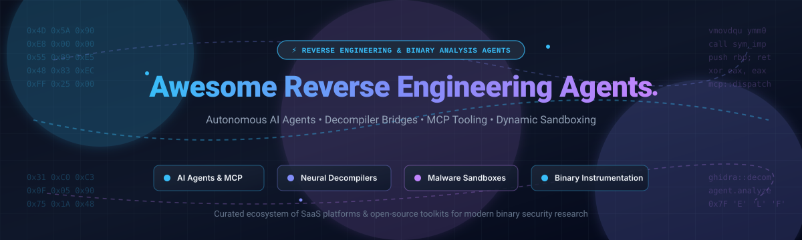
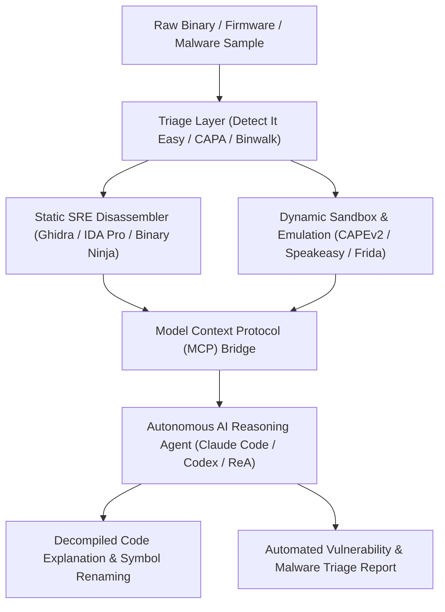

 
 

  

# 🔬 Awesome Reverse Engineering & Binary Analysis Agents 🤖

### *Curated Directory of Autonomous Binary Analysis AI Agents, Disassemblers, Neural Decompilers, MCP Servers & Dynamic Sandboxes*

**Last updated:** November 2026

---

## 📖 Executive Summary & SEO Overview

Welcome to the definitive hub for **AI-powered Reverse Engineering & Autonomous Binary Analysis Agents**. Modern software security analysis has transformed from purely manual disassembly into an agentic paradigm where **Large Language Models (LLMs)**, **Model Context Protocol (MCP)** bridges, and **dynamic binary instrumentation engines** collaborate to dissect native binaries (PE, ELF, Mach-O), firmware dumps, WebAssembly, and zero-day malware without source code.

Whether you are performing automated vulnerability discovery, firmware security vetting, CTF exploitation, or software supply chain audit, this directory provides a comprehensive benchmark comparing leading **enterprise SaaS platforms** and high-velocity **open-source security tooling**.

---

## 📑 Table of Contents
- [📊 Sector Overview & Market Dynamics](#-sector-overview--market-dynamics)
- [☁️ SaaS & Hosted Commercial Platforms](#️-saas--hosted-commercial-platforms)
- [🔓 Open-Source GitHub Projects](#-open-source-github-projects)
- [🛠️ Architecture & custom Agent System Design](#️-architecture--custom-agent-system-design)
- [🤝 How to Contribute](#-how-to-contribute)
- [💖 Support](#-support)
- [📈 Star History](#-star-history)
- [⚠️ Disclaimer](#️-disclaimer)

---

## 📊 Sector Overview & Market Dynamics

The global **Binary Analysis and Software Reverse Engineering Market** is estimated at **$2.04 Billion** (as of 2024–2026) and is projected to expand to **$5.42 Billion** by 2032, advancing at a Compound Annual Growth Rate (**CAGR**) of **17.2%** (with the broader automated malware and supply chain analysis segment exceeding $12 Billion).

The industry is **moderately fragmented**: entrenched disassembler and decompiler providers (e.g., Hex-Rays / IDA Pro, Vector 35 / Binary Ninja) dominate manual desktop reverse engineering, while high-velocity venture-backed security platforms (e.g., ReversingLabs, Intezer, Binarly, RevEng.AI) compete for automated cloud-scale triage and AI-driven firmware vetting. As manual binary reversing remains a severe talent bottleneck, the market is aggressively pivoting toward **AI agent-driven autonomous workflows**, multi-tool MCP servers, and continuous software bill of materials (SBOM/xBOM) validation.

---

## ☁️ SaaS & Hosted Commercial Platforms

Below is a detailed comparison of prominent enterprise SaaS and cloud-enabled platforms for binary analysis, firmware security, and automated malware triage, sorted by company size (valuation / estimated annual revenue in descending order).

| Company / Product | Company Size (Valuation / Revenue) | Starting Pricing Tier | Free Tier Limits / Free Trial Limits | Key Capabilities & Highlights |
| :--- | :--- | :--- | :--- | :--- |
| **[ReversingLabs (Spectra Analyze)](https://reversinglabs.com)** | **$340M+ Valuation** (~$75M–$80M ARR) | Starting tier from **$500/month** (Community+); Custom enterprise contracts start at ~$28,000/year | **14-day full-feature free trial** (Spectra Assure evaluation without credit card) & public Community lookup tier | High-speed static binary decomposition, Software Bill of Materials (xBOM) security, and file analysis across 4,800+ file formats. |
| **[Hex-Rays (IDA Pro & Cloud)](https://hex-rays.com)** | **~$120M–$150M Valuation** (€20M+ Revenue, Acquired by Smartfin) | **$365/year** (IDA Home tier; IDA Pro starts at $1,999/year named license) | **Free forever plan (IDA Free)**: restricted to x86/x64 architecture only, cloud-based decompiler, strictly non-commercial use | Industry-standard commercial multi-architecture disassembler, interactive Lumina function database, and decompilers across 70+ ISAs. |
| **[Intezer (Intezer Analyze)](https://intezer.com)** | **$80M+ Valuation** (~$11M ARR; $68M Total Funding) | Starting tier at **$399/month** (Advanced Triage); Custom Enterprise SOC quotes | **Free forever community plan**: **10 public file scans per month**; includes a 14-day introductory trial with up to 500 scans | Genetic code reuse detection, automated Autonomous SOC triage, malware family classification, and unpacker extraction. |
| **[Binarly (Transparency Platform)](https://binarly.io)** | **~$50M–$100M Valuation** (~$6.8M ARR; $14.1M Total Funding) | Starting commercial Lite tier estimated at **$1,500/month** (Enterprise SaaS by quote) | **Free forever web tool (FwHunt.RUN)**: unlimited public web-based firmware/binary scans without registration; 14-day enterprise PoC trial | Deep firmware, UEFI/BIOS security, cryptographic key leak detection, and hardware supply chain vulnerability discovery. |
| **[VMRay Analyzer](https://vmray.com)** | **~$45M–$60M Valuation** (~$25.5M Revenue; $28.9M Total Funding) | Starting entry cloud package at **€3,200/year** (~$3,500/year); Enterprise custom | **14-day proof-of-concept (PoC) enterprise trial** (upon sales application approval) with dedicated detonation quota | Agentless, hypervisor-level dynamic malware analysis evasion-resistant sandbox with automated threat verdicts. |
| **[RevEng.AI](https://reveng.ai)** | **~$35M–$50M Valuation** ($20.6M Raised via NATO Innovation Fund & In-Q-Tel) | Enterprise subscription starting tier estimated at **$1,200/month** (Annual billing) | **14-day structured pilot trial** with sandbox API access (requires enterprise inquiry and verification) | Proprietary neural network (*BinNet*) for AI binary similarity, function boundary recovery, and cross-architecture matching. |
| **[Binary Ninja Cloud (Vector 35)](https://binary.ninja)** | **~$20M–$30M Valuation** (Privately held, In-Q-Tel backed, ~$4M–$6M Revenue) | Non-commercial desktop license at **$299**; Commercial named license starts at **$1,799/year** | **Free forever plan (Binary Ninja Free Desktop & Cloud)**: restricted to x86, x86_64, ARMv7, ARMv8 architectures; no API or plugin automation | Advanced Intermediate Language tiers (LLIL, MLIL, HLIL), collaborative cloud sync, type inference, and native decompilation. |
| **[JEB Decompiler (PNF Software)](https://pnfsoftware.com)** | **~$8M–$12M Valuation** (Privately held / bootstrapped, ~$2M–$3M Revenue) | **$1,200/year** (JEB Android) or **$140/month**; JEB Pro full suite at **$2,000/year** | **Free forever plan (JEB Community Edition / CE)**: limited to x86/x64 desktop binaries; Free demo version restricts decompilation output | Modular enterprise decompiler for Android APK/Dalvik, WebAssembly, Ethereum Smart Contracts, and embedded microcontrollers. |

---

## 🔓 Open-Source GitHub Projects

Explore the most powerful open-source disassemblers, headless decompiler bridges, dynamic instrumenters, and Model Context Protocol (MCP) servers for autonomous AI agents. Sorted by GitHub star counts (descending).

| Project | GitHub Stars Badge | Description & Capabilities |
| :--- | :---: | :--- |
| **[morluto/rea](https://github.com/morluto/rea)** |  | Open-source MCP server and CLI toolkit connecting AI coding agents (Claude Code, Codex, Cursor, Gemini CLI) to Ghidra, Hopper, and IDA Pro to reverse engineer native binaries with verifiable evidence. |
| **[NationalSecurityAgency/ghidra](https://github.com/NationalSecurityAgency/ghidra)** |  | NSA's flagship open-source software reverse engineering (SRE) suite featuring multi-architecture decompiler, headless analysis scripting, and multi-user collaboration server. |
| **[WerWolv/ImHex](https://github.com/WerWolv/ImHex)** |  | Modern hex editor for reverse engineers, featuring custom pattern language engine, memory visualizer, data disassembler, and automated struct decoding. |
| **[skylot/jadx](https://github.com/skylot/jadx)** |  | Dex-to-Java decompiler providing both command-line and GUI interfaces for reverse engineering Android DEX, APK, and Smali bytecode into clean Java source code. |
| **[x64dbg/x64dbg](https://github.com/x64dbg/x64dbg)** |  | Open-source x64/x32 dynamic binary debugger for Windows, supporting TitanEngine, memory patching, scriptable automation, and an extensive plugin ecosystem. |
| **[icsharpcode/ILSpy](https://github.com/icsharpcode/ILSpy)** |  | Modern open-source .NET assembly browser and C# decompiler supporting PDB symbol generation, BAML resources, and cross-platform desktop inspection. |
| **[radareorg/radare2](https://github.com/radareorg/radare2)** |  | UNIX-like reverse engineering framework, command-line disassembler, hex editor, debugger, binary patching utility, and scriptable native shell. |
| **[frida/frida](https://github.com/frida/frida)** |  | Dynamic instrumentation toolkit enabling security analysts to inject custom JavaScript hooks into native apps across Windows, macOS, Linux, iOS, and Android. |
| **[rizinorg/cutter](https://github.com/rizinorg/cutter)** |  | Free, open-source Qt-based GUI for the Rizin reverse engineering framework, tightly integrated with the Ghidra decompiler and interactive control-flow graphs. |
| **[ReFirmLabs/binwalk](https://github.com/ReFirmLabs/binwalk)** |  | Fast tool for searching, analyzing, and extracting embedded firmware filesystem images, compressed headers, and bootloader payloads. |
| **[LaurieWired/GhidraMCP](https://github.com/LaurieWired/GhidraMCP)** |  | High-performance Model Context Protocol (MCP) server enabling LLMs and autonomous agents to query Ghidra, decompile functions, and trace cross-references. |
| **[horsicq/Detect-It-Easy](https://github.com/horsicq/Detect-It-Easy)** |  | Programmatic binary file signature verifier and packer detector detecting compilers, obfuscators, and linkers for PE, ELF, and Mach-O files. |
| **[unicorn-engine/unicorn](https://github.com/unicorn-engine/unicorn)** |  | Lightweight, multi-architecture CPU emulator framework based on QEMU, supporting safe execution of isolated shellcode and disassembled instructions. |
| **[angr/angr](https://github.com/angr/angr)** |  | Powerful Python binary analysis framework combining static analysis with symbolic (concolic) execution for automated vulnerability triage and constraint solving. |
| **[bethington/ghidra-mcp](https://github.com/bethington/ghidra-mcp)** |  | Model Context Protocol bridge between AI assistants and local Ghidra headless scripts for automated symbol renaming and function summarization. |
| **[mandiant/capa](https://github.com/mandiant/capa)** |  | Open-source capability detection tool that automatically identifies capabilities and malicious behaviors in executable binaries using human-readable rules. |
| **[rizinorg/rizin](https://github.com/rizinorg/rizin)** |  | Portable, modern reverse engineering framework and binary analysis toolset focusing on usability, clean APIs, and scriptable instrumentation. |
| **[kevoreilly/CAPEv2](https://github.com/kevoreilly/CAPEv2)** |  | Automated malware analysis sandbox based on Cuckoo Sandbox, specialized in automatic payload unpacking, config extraction, and evasion handling. |
| **[mandiant/speakeasy](https://github.com/mandiant/speakeasy)** |  | Portable binary emulator designed to emulate Windows user-mode applications, kernel-mode drivers, and raw shellcode without virtual machines. |
| **[CYB3RMX/Qu1cksc0pe](https://github.com/CYB3RMX/Qu1cksc0pe)** |  | Multi-platform static malware analysis and binary triage framework analyzing Windows PE, Linux ELF, macOS Mach-O, and Android APK payloads. |
| **[LING71671/open-reverselab](https://github.com/LING71671/open-reverselab)** |  | AI-powered reverse engineering workstation application connecting autonomous LLM agents to Ghidra, Frida, and x64dbg via standardized MCP endpoints. |
| **[guanyue91141/GhidraMCP-AI-rename](https://github.com/guanyue91141/GhidraMCP-AI-rename)** |  | Ghidra MCP server specialized in AI-driven semantic variable, function renaming, and control-flow explanation. |
| **[dnakov/frida-mcp](https://github.com/dnakov/frida-mcp)** |  | MCP server giving autonomous AI agents live Frida instrumentation access to trace APIs, inspect memory, and hook functions on desktop and mobile. |
| **[clearbluejar/pyghidra-mcp](https://github.com/clearbluejar/pyghidra-mcp)** |  | Python-based Ghidra MCP server enabling Claude, Cursor, and ChatGPT agents to decompile binaries headlessly via PyGhidra. |
| **[biniamf/ai-reverse-engineering](https://github.com/biniamf/ai-reverse-engineering)** |  | Local, evidence-first static analysis workbench combining a web UI and LLM copilot with a headless Ghidra Docker service. |
| **[gengstah/windbg-mcp](https://github.com/gengstah/windbg-mcp)** |  | Open-source Model Context Protocol server exposing WinDbg DbgEng debugging sessions, crash dumps, and register inspection to AI agents. |
| **[tuna1999/dnspy-mcp](https://github.com/tuna1999/dnspy-mcp)** |  | Model Context Protocol server for dnSpyEx enabling AI coding assistants to decompile and inspect .NET bytecode directly. |

---

## 🛠️ Architecture & Custom Agent System Design

When architecting a production autonomous reverse engineering pipeline, security engineers combine specialized layers into an integrated agent harness:

---

## 🤝 How to Contribute

We actively welcome contributions to expand and refine this ecosystem directory!

1. 🍴 **Fork the repository** to your GitHub profile.
2. 🌿 **Create a new branch**: `git checkout -b feature/add-new-agent-tool`.
3. 📝 **Add or update entries** in `README.md` following the tabular layout. Ensure:
   - Tool name, official URL, and exact GitHub repository path are verified.
   - For SaaS tools: include starting tier pricing and specific free plan/trial limits.
   - For Open-Source tools: include the standard social stargazers badge.
4. 🚀 **Commit your changes**: `git commit -m 'Add ToolName to awesome reverse engineering agents'`.
5. 📬 **Open a Pull Request** with a brief summary explaining the tool's relevance to binary analysis or AI agents.

---

## 💖 Support

If you find this curated collection helpful for your research, security investigations, or daily reverse engineering workflow, please consider showing your support:

- ⭐ **Star this repository** to help other researchers discover it!
- 🍴 **Fork & share** with your cybersecurity and reverse engineering community.
- ☕ **Buy me a coffee & support ongoing maintenance:** Visit the [Sponsor Dashboard on GitHub](https://github.com/sponsors/ishandutta2007).

Your sponsorship directly funds ongoing tracking of the AI binary analysis ecosystem!

---

## 📈 Star History

---

## ⚠️ Disclaimer

- This curated list is maintained for educational, defensive cybersecurity, and security research purposes only.
- Always analyze unknown binaries, suspected malware, and zero-day samples inside isolated virtual machines, network-isolated sandboxes (e.g., CAPEv2), or air-gapped test environments.
- Only perform reverse engineering on software and firmware that you own, have explicit authorization to test, or are legally permitted to analyze under applicable research exemptions and copyright laws.

---

<b>Built with ❤️ for reverse engineers, malware analysts, CTF players, and AI security researchers worldwide.</b>

